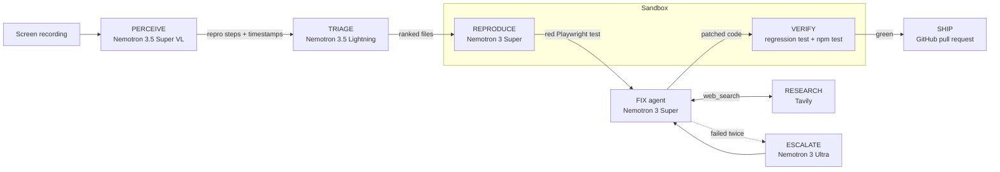

# Repro

**Show it the bug. It ships the fix.**

Repro watches a screen recording of a bug, writes a Playwright test that fails because of it, fixes
the code until that test passes (without breaking the existing suite), and opens a GitHub pull
request with the fix, the new regression test and the red/green evidence. No human writes any of it.

Built for the **Nebius x NVIDIA Global AI Hackathon** (Coding and Agentic Engineering track) on
**NVIDIA Nemotron** models served by **Nebius Token Factory**, with live web research by **Tavily**.


## Why

Bug reports are often just a video: "it does this, see attached". Turning that into a fix means
watching it, working out the exact steps, reproducing it locally, writing a test, finding the root
cause, fixing it and proving the fix. Repro does that whole loop, and every claim it makes in the
pull request is backed by a test that went from red to green.

## How it works



1. **Perceive.** ffmpeg picks keyframes just *before* and just *after* every visible change. The
   vision model transcribes each one (pointer position, every value on screen); a deterministic diff
   turns those transcripts into a timeline ("Logo Cap row disappeared, triggered on: Remove link in
   the Logo Cap row"). The model then writes a structured `ReproReport` from the timeline, the
   keyframes and the video.
2. **Triage.** The fast Lightning model ranks the files to read first from a compact repository map.
3. **Reproduce.** Nemotron 3 Super writes a Python Playwright test from the report, the start
   page's accessibility tree and the app's element templates. It runs in a sandbox (AST safety
   check, separate process, timeouts) and is classified *red* (proves the bug), *green* (misses it)
   or *broken* (test bug), with feedback until it is red.
4. **Fix.** A tool-calling agent (`read_file`, `search_code`, `edit_file`, `run_tests`,
   `web_search`, ...) patches a throwaway copy of the app. It cannot edit existing tests, and
   `finish` is only accepted after a fully green run. After two failed runs Nemotron 3 Ultra takes
   over the same conversation.
5. **Verify.** The regression test and the existing suite run once more on the final code.
6. **Ship.** The fix and the regression test (under `e2e/`) are committed to a new branch through
   the GitHub API, and a pull request links every repro step to its timestamp in the video.

Every stage emits events (stage, model, status, tokens, latency, payload) that the web UI streams
live over Server-Sent Events.

## How Repro uses Nemotron, Nebius Token Factory and Tavily

All model calls go through Nebius Token Factory's OpenAI-compatible API (`app/llm.py`), with
guided JSON decoding for structured outputs and native function calling for the agent.

| Stage | Model | Why this model |
|-------|-------|----------------|
| Perceive | `nvidia/Nemotron-3.5-Super-VL` | Vision-language model that accepts both video and images. Used with thinking **off** for per-frame transcription (cheap reading) and **on** for the final report (reasoning over the timeline). |
| Triage | `nvidia/Nemotron-3_5-Lightning` | Fast and cheap, enough to rank files from a repo map; saves tool calls on the expensive coder. |
| Reproduce | `nvidia/nemotron-3-super-120b-a12b` | Strong coding model; writes the Playwright test and corrects it from sandbox feedback. |
| Fix | `nvidia/nemotron-3-super-120b-a12b` | Reliable function calling for a multi-step agent loop. |
| Escalate | `nvidia/Nemotron-3-Ultra-550b-a55b` | Largest model, used only when Super fails twice, so its cost is paid only on hard bugs. |
| Research | Tavily Search + Extract | Live, LLM-ready web results on error messages and library behaviour, called by the agent as a tool; every query and source is logged and cited in the PR. |

Token Factory limits we designed around: at most 8 images per request (keyframes are transcribed
in batches of 8), and reasoning tokens that count against `max_tokens` (each call has a budget and
retries with thinking off if the model never gets to the answer).

## Results

Measured on the three ShopLite sample recordings (`samples/`), against ground truth recorded by
the sample generator (`samples/ground_truth.json`, `samples/*.events.json`).

**Perceive** (`python -m scripts.eval_perception --modes hybrid --runs 2`)

| Mode | Step recall | Key facts correct | Tokens per video |
|------|-------------|-------------------|------------------|
| hybrid (video + keyframe timeline) | 100% | 6/6 | 21k to 26k |
| frames (keyframe timeline only) | 100% | 6/6 | 21k to 24k |
| video only | 58% | 2/6 | 8k to 16k |

The first version scored 2/6: the model credited a removal to the row that slid under the cursor
afterwards, dropped minus signs, and its hidden reasoning sometimes used the whole output budget.
Before/after keyframes, the deterministic timeline diff and explicit token budgets fixed that.

**Reproduce** (`python -m scripts.eval_reproduce`): a test counts only if it is **red on the buggy
app and green on a reference-fixed app** (`samples/reference/cart.fixed.js`).

| Bug | Red on buggy app | Green on fixed app | Attempts | Tokens (reproduce only) |
|-----|------------------|--------------------|----------|-------------------------|
| Coupon stacks | yes | yes | 1 (sometimes 2) | about 5k per attempt |
| Remove keeps the price | yes | yes | 1 | about 5k |
| Quantity goes negative | yes | in about half of the runs | 1 | about 5k |

The quantity bug's correct behaviour is ambiguous: "stop at 0", "remove at 0" and "clamp at 1" are
all reasonable fixes, and the reference clamps at 1. Tests that assert "stays at 0" are reported
as a reasonable alternative rather than forced to match.

**Full pipeline** (`python -m scripts.eval_pipeline`): checks that the agent's fix behaves like the
reference fix on the same cart scenario, that the existing suite still passes, and that a PR opens.
Run with `--reuse-reports`, so perception (about 21k to 26k tokens per video, above) is not counted.

| Bug | Red test | Fixed | VERIFY green | Behaves like reference | Escalated | Tokens (triage to PR) | Result |
|-----|----------|-------|--------------|------------------------|-----------|-----------------------|--------|
| Coupon stacks | yes | yes | yes | yes | no | 65k | [shoplite#3](https://github.com/princemittalr/shoplite/pull/3) |
| Remove keeps the price | yes | yes | yes | yes | no | 56k | run without a PR |

The first coupon run failed and cost 196k tokens: `read_file` printed `  57    const code`, and
both Super and Ultra read the line-number padding as indentation, so all 20 of their edits missed
by two spaces. `read_file` now separates the number with a tab, and `edit_file` accepts an
`old_text` that differs only in indentation and re-indents the replacement to match the file.
The whole session (key check, three pipeline runs) used about 317k tokens.

The orchestration, the fix loop (with a scripted stand-in for the model: real edits, real test
runs, escalation after two red runs, refused edits to existing tests), VERIFY and the PR text are
covered offline by `tests/`.

## Quick start

Requirements: Python 3.11+, Node.js 20+, ffmpeg, git.

**Windows (PowerShell)**

```powershell
python -m venv .venv
.\.venv\Scripts\Activate.ps1
pip install -r requirements.txt
playwright install chromium
copy .env.example .env        # then fill in your keys (see docs/SETUP.md)
uvicorn app.main:app --reload # open http://127.0.0.1:8000
```

**macOS / Linux**

```bash
python3 -m venv .venv
source .venv/bin/activate
pip install -r requirements.txt
playwright install chromium
cp .env.example .env          # then fill in your keys (see docs/SETUP.md)
uvicorn app.main:app --reload # open http://127.0.0.1:8000
```

Install ffmpeg with `winget install Gyan.FFmpeg`, `brew install ffmpeg` or `apt install ffmpeg`.

**Docker**

```bash
docker build -t repro .
docker run --env-file .env -p 8000:8000 repro
```

### Command line

```bash
python -m scripts.run_pipeline samples/shoplite-coupon.mp4            # video in, PR out
python -m scripts.run_pipeline samples/shoplite-remove.mp4 --no-pr    # stop after verify
python -m scripts.perceive samples/shoplite-coupon.mp4                # repro steps only
python -m scripts.reproduce samples/shoplite-coupon.mp4               # red Playwright test only
python -m scripts.eval_perception --modes hybrid --runs 2
python -m scripts.eval_reproduce
python -m scripts.eval_pipeline
python -m unittest discover tests                                     # offline unit tests
```

### Web UI styles

The CSS is built with Tailwind and committed (`app/static/css/site.css`), so the server needs no
Node build step. After changing classes in `app/static/`, rebuild it:

```bash
npx -y tailwindcss@3.4.17 -c tailwind.config.js -i app/static/css/site.src.css -o app/static/css/site.css --minify
```

Every number and quote on the landing page comes from the recorded runs in `demo/` and the evals
above; `tests/test_web.py` checks them against the recordings. Colours are semantic tokens
(`fix`, `bug`, `replay`, `ink`, `surface-1`...) defined once in `tailwind.config.js` and
`site.src.css`; raw palette classes like `text-emerald-400` don't compile.

### Fast first load (no cold start)

A free Render instance sleeps after 15 minutes idle and takes 30 to 60 seconds to wake. Two
optional fixes, which work together:

1. **Serve the landing page from a CDN.** `python -m scripts.build_static` writes a static copy of
   the landing page, its assets and the sample videos to `dist/site`. Its "try it" links point at
   the API (`REPRO_API_ORIGIN`, default `https://repro-yrgp.onrender.com`) and the page pings
   `/api/health` on load, so the server wakes while the visitor reads. Deploy `dist/site` to
   Netlify, Cloudflare Pages or GitHub Pages; set `SITE_URL` to the new address for the canonical
   and Open Graph links. The API allows cross-origin `GET` only.
2. **Keep the server warm.** `.github/workflows/keep-warm.yml` pings `/api/health` every 10
   minutes from 07:30 to 20:30 IST (about 400 of the 750 free instance hours a month). Set the
   repository variable `REPRO_URL` if the service moves.

## Project layout

| Path | What it is |
|------|------------|
| `app/perception.py`, `app/video.py` | PERCEIVE: keyframes, transcription, timeline diff, report |
| `app/triage.py` | TRIAGE: repo map and file ranking |
| `app/reproduce.py`, `app/sandbox.py`, `app/harness.py` | REPRODUCE: test writing, safety check, sandboxed runner |
| `app/fix.py`, `app/research.py`, `app/checks.py` | FIX agent, Tavily research, regression + suite checks |
| `app/ship.py` | SHIP: branch, commit and pull request via the GitHub API |
| `app/pipeline.py`, `app/events.py` | Stage orchestration and SSE-ready events |
| `app/main.py`, `app/runs.py`, `app/showcase.py`, `app/static/` | Web UI and API: landing page at `/`, the tool at `/app`, real recent runs at `/api/recent` |
| `scripts/build_static.py` | Static export of the landing page for a CDN host |
| `shoplite/` | The demo app with three deliberate bugs ([its own repo](https://github.com/princemittalr/shoplite)) |
| `samples/` | Sample recordings and ground truth for the evals |
| `demo/` | Recorded real runs for the UI's instant Replay |

## Limitations

- Target apps must start with `npm start` (Node). Other stacks need a start command in `app/target.py`.
- Regression tests are Python Playwright; the fix agent's unit tests follow the app's own framework.
- Perception is tuned on short (under a minute), single-page recordings; long, multi-page sessions
  are sampled more coarsely.
- When a bug's correct behaviour is ambiguous, the test may encode one reasonable fix (see the
  quantity bug above).
- Generated code runs in a sandboxed subprocess with an AST allow-list and timeouts; for untrusted
  repositories, run Repro itself in a container (see the Dockerfile).
- Cost per run is shown in tokens; dollar estimates need Token Factory prices in `app/usage.py`.

## License

MIT, see [LICENSE](LICENSE).
